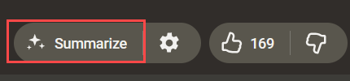

**YouTube Free AI Summary** adds a button to YouTube that grabs the current video's subtitles and drops them straight into a freshly opened AI chat — your choice of Google AI Studio, Gemini, ChatGPT, Claude, or Grok — ready to be summarized.

It is built to solve the two problems other summary scripts run into: they can't get the subtitles of restricted videos, and long transcripts don't reach the AI in one piece, so you end up with a summary of only part of the video.

Once installed, a **Summarize** button (outlined in red) appears next to the like / dislike buttons on the video page. One press and it starts.

## Features

- **Completely free** — No API key, no payment, no subscription; you only need to be logged into the AI service you picked
- **One click** — Adds a button to the YouTube video page: press it and the subtitles are captured, your AI opens, and the summary starts
- **Choice of AI service** — Google AI Studio, Gemini, ChatGPT, Claude, or Grok — pick your usual one in the settings
- **Works on restricted videos** — Members-only, age-restricted and region-locked videos can be summarized too, as long as you can watch them yourself
- **Long videos aren't cut short** — The whole transcript reaches the AI, so the summary won't stop halfway through
- **Summarize without opening the video** — Hover any video thumbnail for a button that summarizes it right there; pick which corner it sits in, or turn it off, in the settings
- **Custom prompt** — Write your own prompt in the settings to control how the AI summarizes and what it focuses on
- **10 interface languages** — English, 繁體中文, 简体中文, 日本語, 한국어, Español, Français, Deutsch, Português (BR), Русский

## How to use

1. Open any YouTube video that has subtitles
2. Click the **Summarize** button next to the like / dislike buttons — the subtitles are captured and your chosen AI opens with the prompt already filled in
3. If you aren't signed in to that AI site yet, sign in once — a normal free account is enough
4. Click the gear next to the button to open the settings: AI service, interface language, custom prompt, preferred subtitle languages, thumbnail button position, timestamps, auto-submit

If the button doesn't show up when you hover a thumbnail, turn off video previews on hover in [YouTube's playback settings](https://www.youtube.com/account_playback).

## Requirements

- Tampermonkey, or another userscript manager
- A logged-in account on the AI service you pick — no API key, no payment, no subscription

## Privacy

- **No data collection** — No analytics, no tracking, and no server of the author's involved
- **Subtitles go only to the AI you picked** — They are read from YouTube and placed into the chat of the AI service you chose, in your own browser, and nowhere else
- **Your YouTube sign-in is used only with YouTube** — When you summarize a restricted video (members-only, age-restricted) from its thumbnail, the script asks YouTube for the subtitles as you, using the sign-in already in your browser. That request goes to `youtube.com` only; your sign-in is never stored, logged, or sent to the AI service or anyone else
- **You can turn that off** — Untick "Use my YouTube sign-in…" in the settings and restricted videos are opened in a short-lived tab to read their subtitles instead
- **Settings stay local** — They are stored by your userscript manager on your own computer

## Source & support

- Source code: https://github.com/nathan60107/YoutubeFreeAISummary
- Bug reports & feature requests: https://github.com/nathan60107/YoutubeFreeAISummary/issues
- License: MIT
