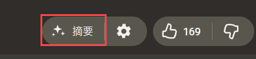

**YouTube Free AI Summary** 會在 YouTube 上增加一個按鈕，擷取目前影片的字幕，並直接丟進新開的 AI 對話分頁——可自由選擇 Google AI Studio、Gemini、ChatGPT、Claude 或 Grok——讓你立刻進行總結。

它專門解決其他總結腳本會遇到的兩個問題：抓不到受限影片的字幕，以及字幕太長時沒能完整送進 AI、摘要只做了一半。

安裝後，影片頁的喜歡／不喜歡按鈕旁會出現**摘要**按鈕（紅框處），按一下就開始。

## 功能特色

- **完全免費** — 不需要 API 金鑰、不需付費、也不需訂閱，你只要已登入所選的 AI 服務
- **一鍵完成** — 在 YouTube 影片頁多一顆按鈕，按下就會擷取字幕、開好 AI，摘要立刻開始
- **可選擇 AI 服務** — Google AI Studio、Gemini、ChatGPT、Claude 或 Grok，在設定中挑你慣用的那一個
- **受限影片也能摘要** — 會員專屬、年齡限制、地區限定的影片，只要你自己看得到就摘要得了
- **再長的影片也不會被截斷** — 完整字幕都會送進 AI，不會摘要到一半就停住
- **在觀看頁面外摘要** — 滑鼠移到任何影片縮圖就會浮現按鈕，不必開啟影片也能摘要；按鈕位置可在設定中選擇四個角落之一，也可以關閉
- **自訂提示詞** — 可在設定中自訂提示詞，決定 AI 要怎麼整理、著重講什麼
- **10 種介面語言** — English、繁體中文、简体中文、日本語、한국어、Español、Français、Deutsch、Português (BR)、Русский

## 使用方式

1. 打開任何一部有字幕的 YouTube 影片
2. 按下喜歡／不喜歡按鈕旁的**摘要**按鈕，腳本會擷取字幕並開啟你選擇的 AI，提示詞已自動填好
3. 如果那個 AI 網站還沒登入，先登入一次就好（一般免費帳號即可）
4. 按下按鈕旁的齒輪可開啟設定：AI 服務、介面語言、自訂提示詞、偏好字幕語言、縮圖按鈕位置、時間戳、自動送出

如果滑鼠移到縮圖上沒有出現按鈕，請到 [YouTube 播放設定](https://www.youtube.com/account_playback)關閉「影片預覽功能」。

## 使用需求

- Tampermonkey 或其他使用者腳本管理器
- 已登入你所選的 AI 服務——不需要 API 金鑰、不需付費、不需訂閱

## 隱私

- **不蒐集任何資料** — 沒有分析追蹤，也不經過作者的任何伺服器
- **字幕只會送到你選的 AI** — 字幕從 YouTube 讀取後，只會在你自己的瀏覽器裡放進你所選 AI 服務的對話框，不會送到其他地方
- **YouTube 登入狀態只用於 YouTube** — 從縮圖摘要受限影片（會員專屬、年齡限制）時，腳本會以你的身分、使用瀏覽器中既有的登入狀態向 YouTube 請求字幕。這個請求只會送到 `youtube.com`；登入資訊不會被儲存、記錄，也不會傳給 AI 服務或任何第三方
- **可以關閉** — 在設定中取消勾選「從縮圖摘要受限影片時，使用我的 YouTube 登入狀態…」，受限影片就會改為短暫開啟影片分頁來讀取字幕
- **設定只存在本機** — 設定值由你的使用者腳本管理器儲存在你自己的電腦上

## 原始碼與支援

- 原始碼：https://github.com/nathan60107/YoutubeFreeAISummary
- 問題回報與功能建議：https://github.com/nathan60107/YoutubeFreeAISummary/issues
- 授權：MIT
